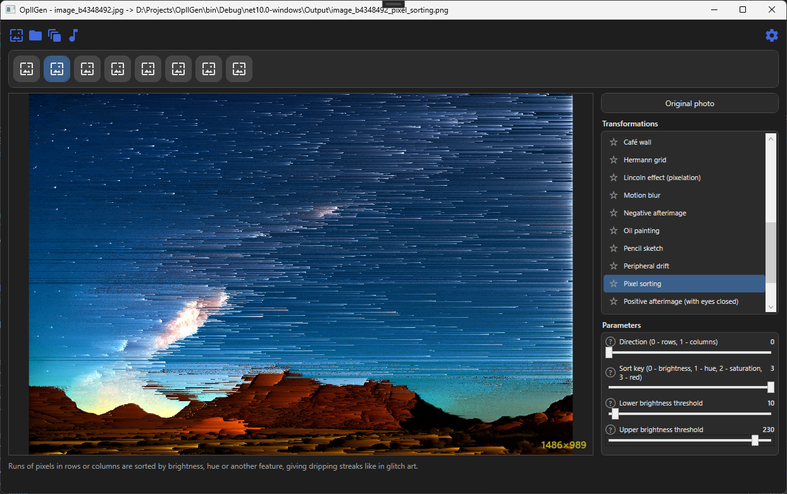
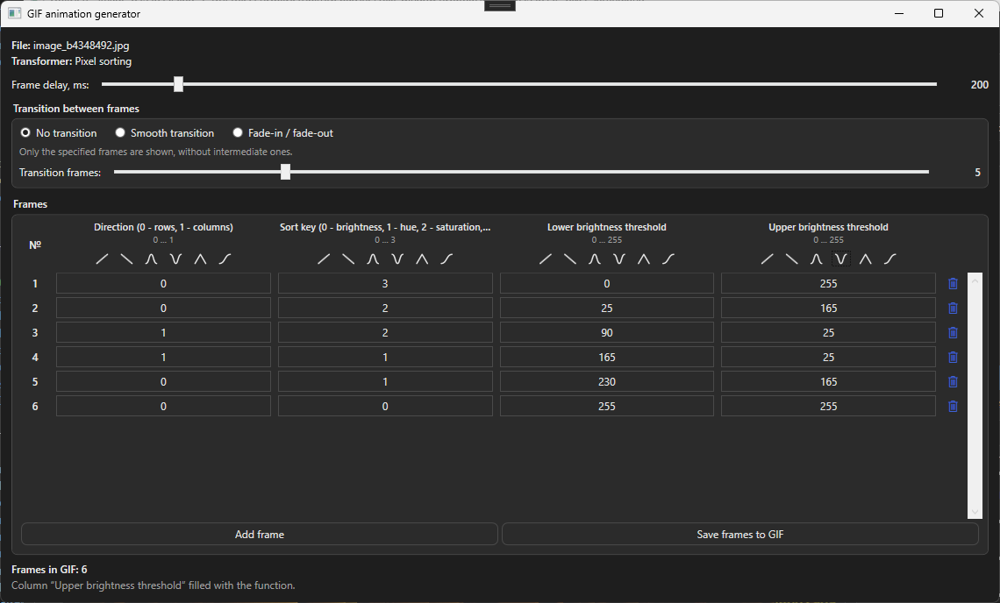
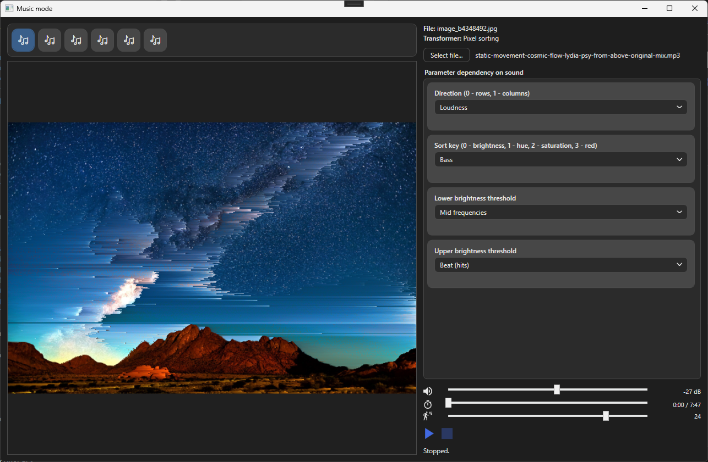

# OpIlGen

A WPF application (.NET 10) that turns images into optical illusions and artistic effects.
Built with MVVM (CommunityToolkit.Mvvm), dependency injection (Microsoft.Extensions.DependencyInjection) and NAudio for audio analysis.
Results are saved to the `Output` folder next to the exe, settings are stored in `%APPDATA%\OpIlGen\settings.json`.

## Screenshots

<table width="100%">
  <tr>
    <td width="33%"></td>
    <td width="33%"></td>
    <td width="33%"></td>
  </tr>
</table>

## Image transformers (27 in total)
- **Basic:** Original photo, Black and white (2 colors), Lincoln effect (pixelation)
- **Afterimages:** Negative afterimage, Positive afterimage (visible with eyes closed)
- **Halftone and dithering:** Floyd-Steinberg, Bayer (ordered), Halftone
- **Perception illusions:** Hermann grid, Café wall, Autokinetic illusion, Peripheral drift
- **Drawing and painting:** Pencil sketch, Oil painting, Soft sketch
- **Blurs:** Bokeh soft focus, Motion blur, Surface blur
- **Distortions and generative:** Slit-scan, Displacement map, Pixel sorting, Kaleidoscope, Op art lines, Voronoi / stippling, Flow field, Height map, Rubik's cube

### Adding your own transformer
1. Create a class that implements `IImageTransformer`.
2. Register it in `App.ConfigureTransformers` (registration order = order in the list).
3. Add its texts (name, description, parameters) to `Localization/*.json`.

Parameters (adjustable values that control the result) are declared by overriding `AvailableCustomVariables`; read their values with `customVariables.GetValue(variable)`.

## Additional features
- **GIF generator:** creates frames from several sets of parameter values and stitches them into a GIF. A parameter column can be filled with a function (rise, fall, sine wave, triangle wave, S-curve) using the buttons under its name. Transitions between frames: none, smooth, or fade-in / fade-out. Result: `Output/gif/<file name>.gif`, longer side up to 1024 px.
- **Music mode (image animation):** transformer parameters change in time with the sound (bass, loudness, mid frequencies, high frequencies, beat, brightness) or stay fixed. Mappings are remembered per transformer. Work in progress: a high FPS or a large image will slow rendering down.
- **Full-screen view:** open the result full screen (close with Esc or a double click).
- **Recent images and favorites:** quickly return to previously opened images; pin favorite transformers to the top of the list.
- **Themes and languages:** light / dark theme, English and Russian interface. To add a language, put a `<code>.json` file (for example `de.json`) into `Localization/`.

## Opening an image from a browser
You can add an auto-generated button to web pages (via the Tampermonkey extension) that sends an image straight to the program:
1. Set the path to `OpIlGen.exe` in `Tools/register-opilgen-protocol.reg` and run it. This registers the `opilgen://` protocol in the Windows registry.
2. In Tampermonkey, create a script from `Tools/OpIlGen-open-button.user.js` (the button appears on pages that contain a single jpeg, png, gif, bmp or tiff image).

## Building and releasing
Requires the [.NET 10 SDK](https://dotnet.microsoft.com/download) and Windows.

```powershell
dotnet build -c Release
```

To produce a single `OpIlGen.exe` for the GitHub Releases page, run:

```powershell
.\deploy.ps1
```

The script publishes a single-file, framework-dependent build (`win-x64`) to `publish/` and also creates `publish/OpIlGen-<version>-win-x64.zip`. The .NET runtime is **not** bundled: if it is missing, users need to install the [.NET 10 Desktop Runtime](https://dotnet.microsoft.com/download/dotnet/10.0) separately. See `.\deploy.ps1 -?` for options (version, runtime identifier, GitHub release upload via the `gh` CLI).
